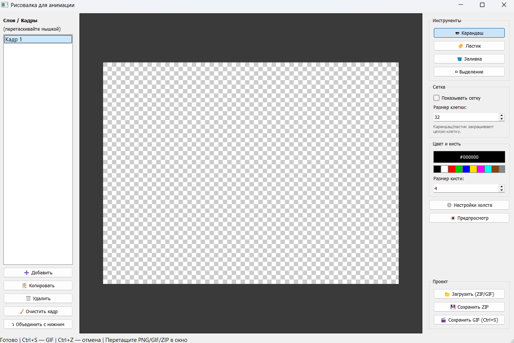

# 🎨 Animation Drawer (Рисовалка для анимации)

**Разработчик:** DeepSeek

Простая и удобная программа для покадровой анимации, созданная на Python (PyQt5). Позволяет рисовать на слоях, настраивать сетку, использовать прозрачный фон и сохранять результат в виде GIF-анимации или архива с PNG-кадрами.

## ✨ Основные возможности

*   **Слои (Кадры):** Добавление, копирование, удаление и очистка. Слои можно перетаскивать мышкой для изменения порядка. Есть функция объединения с нижним слоем.
*   **Инструменты рисования:** 
    *   ✏️ Карандаш
    *   🧽 Ластик (стирает в прозрачность)
    *   🪣 Заливка (автоматическая заливка областей)
    *   ▭ Выделение (можно перемещать выделенную область)
*   **Умная сетка:** Включение/отключение сетки и настройка размера её клеток (от 2 до 500 px). При включенной сетке карандаш и ластик закрашивают/стирают сразу целые клетки.
*   **Масштабирование:** Удобное приближение и отдаление холста (от 5% до 2000%) с помощью колесика мыши.
*   **Предпросмотр:** Встроенный плеер для просмотра получившейся анимации без сохранения файла.
*   **Настройки холста:** Изменение размера рабочей области от 10 до 5000 пикселей.
*   **Импорт:** 
    *   Поддержка Drag & Drop (перетаскивание картинок мышкой прямо в окно программы).
    *   Загрузка готовых GIF-анимаций или ZIP-архивов с кадрами (каждый кадр становится отдельным слоем).
*   **Экспорт:**
    *   Сохранение в **ZIP** (внутри архива — отдельные PNG-файлы для каждого слоя с прозрачностью).
    *   Сохранение в **GIF** (с выбором задержки между кадрами).

## ⌨️ Горячие клавиши

*   **Ctrl + S** — Быстрое сохранение в GIF (в последний указанный файл).
*   **Ctrl + Shift + S** — Сохранить как (выбор нового пути и задержки кадра).
*   **Ctrl + Z** — Отменить действие (до 30 шагов назад).
*   **Ctrl + Y** (или **Ctrl + Shift + Z**) — Повторить действие.
*   **Ctrl + O** — Открыть проект (ZIP или GIF).
*   **Delete** — Очистить выделенную область.
*   **Esc** — Снять выделение.

## 🚀 Как запустить (Портативная версия)

Программа находится на флешке в виде готового исполняемого файла. 
1. Откройте папку с программой.
2. Запустите файл **`AnimationDrawer.exe`** (двойным кликом мыши).
3. Для работы программы не требуется установка Python или других библиотек — всё необходимое уже встроено в файл.

*Примечание: Если Windows Defender или антивирус жалуется на файл, это стандартное ложное срабатывание (из-за метода упаковки PyInstaller). Файл можно смело добавить в исключения.*
